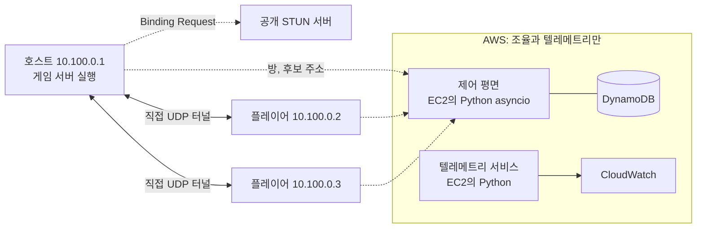
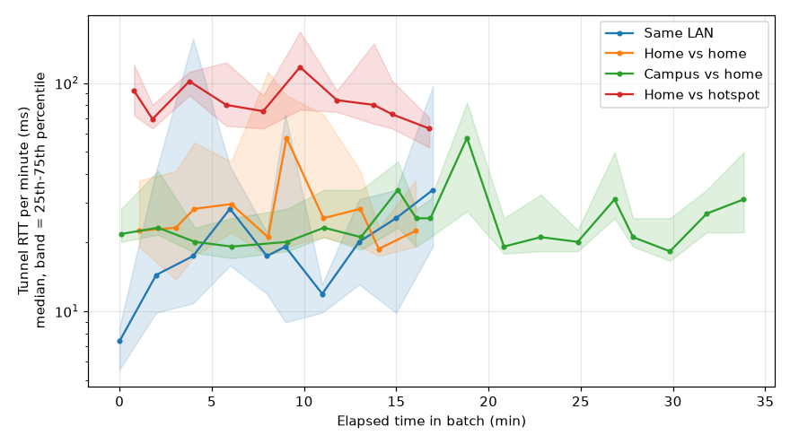
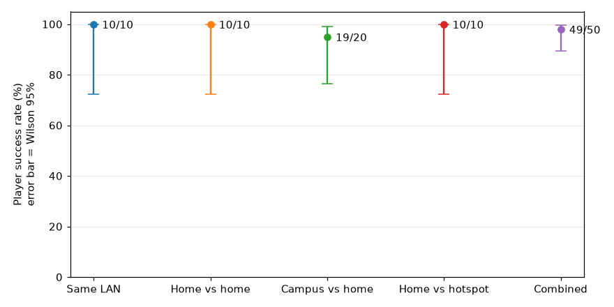

# Sangtachi (상타치)

멀티플레이 게임용 direct-first P2P 가상 LAN입니다. 친구들이 방 코드로 들어오면 포트 포워딩도, 중계 서버도 없이 가상 IP로 호스트의 게임 서버에 접속합니다.

[English](README.md) | **한국어**

**[스펙](docs/kor/spec.md)** · **[아키텍처](docs/kor/architecture.md)** · **[실측 결과](docs/kor/experiments.md)** · **[설계 결정](docs/kor/decisions/)**

## 핵심 성과

- **실제 망 조합 4가지에서 연결 시도 50번 중 49번 직접 연결** (같은 LAN, 가정망 대 가정망, 캠퍼스망 대 가정망, 가정망 대 모바일 핫스팟). 포트 포워딩과 중계 없음. 터널 RTT 중앙값 27.7ms, 패킷 손실 1/1,597.
- **Minecraft Java 멀티플레이 34분 연속 플레이**, 끊김 없음. 표본으로 잰 구간에서 게임에 표시된 핑은 터널 RTT보다 중앙값 **+3.3ms** 높았습니다. 서로 다른 망 4곳에 있는 4인 방에서는 호스트와 플레이어 3명 사이의 3쌍이 모두 직접 연결됐습니다.
- **네트워크 스택을 직접 구현:** RFC 5389 STUN 클라이언트, UDP 홀 펀칭, 20바이트 헤더와 양방향 증거가 있어야 연결로 보는 핸드셰이크를 가진 터널 프로토콜, Wintun(Windows)과 TUN(Linux) 가상 어댑터.
- **AWS는 게임 경로에 없습니다.** 제어 평면과 텔레메트리 서비스를 약 **10분** 동안 함께 멈춰도 이미 연결된 같은 LAN 터널은 끊기지 않았습니다.
- **Catch2 단위 시험 690개 이상, pytest 시험 260개 이상**, 제어 서버와 클라이언트 핵심 코드의 변이 시험, 한국어·영어로 쓴 설계 결정 기록(ADR) 42개.

## 소개

DigiPen Institute of Technology CSP400 캡스톤 개인 프로젝트입니다 (2026년 9월 ~ 진행 중).

친구들과 게임 서버를 열려면 보통 공유기 포트 포워딩과 공인 IP 확인이 필요합니다. 상타치는 공유기 설정 단계를 없앱니다. 공유기를 건드릴 수 없는 곳(CGNAT, 기숙사, 내 것이 아닌 공유기)에서 특히 의미가 있습니다. 모든 설정이 없어지는 것은 아닙니다: 클라이언트에는 관리자 권한이 필요하고 게임 서버에는 여전히 방화벽 예외가 필요합니다 ([`windows-prereq.md`](docs/kor/windows-prereq.md) 15절 사용성 한계). 각 클라이언트가 STUN으로 자기 공인 엔드포인트를 알아내고, UDP 홀 펀칭으로 NAT를 통과해, 게임 트래픽을 P2P 터널로 직접 주고받습니다. 게임 입장에서는 평범한 LAN이라 플레이어는 호스트 `10.100.0.1`의 게임 서버 포트로 접속하면 됩니다. Minecraft Java라면 `10.100.0.1:25565`입니다.

## 기능

- **방 코드로 입장.** 호스트가 GUI에서 방을 만들고 영문과 숫자로 된 6자 코드를 공유합니다. 플레이어는 코드와 표시 이름을 넣고 들어옵니다.
- **멤버 목록.** 호스트가 터널로 보내 주는 목록으로 모두가 각 멤버의 이름과 연결 상태를 봅니다.
- **방당 최대 5명**, 스타 토폴로지: 호스트가 게임 서버를 돌리고 플레이어마다 터널 하나를 유지합니다 ([ADR 0006](docs/kor/decisions/0006-무중계-스타-토폴로지.md)).
- **단계별 실패 코드:** `STUN_DISCOVERY_FAILED`, `CONTROL_PLANE_EXCHANGE_FAILED`, `HOLE_PUNCH_TIMEOUT`, `PEER_HANDSHAKE_FAILED`, `TUNNEL_DROPPED`.
- **Windows GUI와 콘솔, Linux 콘솔 클라이언트**(Ubuntu 24.04 이상). Linux 클라이언트도 Windows 클라이언트와 같은 방에 들어갑니다.
- **게임에 묶이지 않는 터널.** 평범한 IPv4 패킷을 실어 나르며 Minecraft 전용 코드가 없습니다.
- **연결 텔레메트리**(선택). 별도 서비스로 보내 Amazon CloudWatch에서 봅니다. 무엇을 보내는지는 [텔레메트리](#텔레메트리) 절에 있습니다.

## 동작 방식



1. **방.** 호스트가 방을 만들고 플레이어가 제어 평면을 통해 들어옵니다. 제어 평면은 멤버마다 `10.100.0.0/24`에서 가상 IP를 나눠 줍니다. 그러면 각 클라이언트가 가상 어댑터(Windows는 Wintun, Linux는 TUN)를 그 IP와 `10.100.0.0/24` 경로로 올립니다.
2. **발견과 교환.** 각 클라이언트가 나중에 터널에 쓸 바로 그 UDP 소켓으로 공개 STUN 서버들에 동시에 자기 공인 IP와 포트를 묻습니다. 양쪽 피어가 각자 서로 다른 STUN 서버 두 곳에서 같은 엔드포인트를 보면 이 프로젝트의 지원 네트워크 조건을 만족합니다 ([`spec.md`](docs/kor/spec.md) 지원 네트워크 조건). 그다음 제어 평면이 양쪽의 로컬·공인 후보 주소를 서로에게 전달합니다. 게임 트래픽은 보지 않습니다.
3. **펀칭.** 양쪽이 동시에 상대 후보 주소로 `HELLO`를 보냅니다. 두 방향이 모두 증명돼야 연결로 봅니다: 우리 nonce를 되돌려준 `HELLO_ACK`를 받았고, 상대의 유효한 `HELLO`에 답했어야 합니다.
4. **터널.** 가상 어댑터에서 읽은 IP 패킷을 `DATA` 패킷에 담아 상대에게 바로 보내고, 받는 쪽은 안쪽 IPv4의 출발지와 목적지를 확인한 뒤 주입합니다. 어댑터 MTU는 터널 헤더 자리를 남긴 1400입니다 ([`protocol.md`](docs/kor/protocol.md) 12장). 가정망 대 가정망 경로 하나에서 최대 크기 시험을 했을 때 IP 조각은 없었습니다 ([`experiments.md`](docs/kor/experiments.md) 2장 어댑터 MTU).
5. **유지.** 15초마다 keepalive로 NAT 매핑을 살려 두고, 5초마다 `PING`/`PONG`으로 RTT를 잽니다. 상대가 50초 동안 조용하면 `TUNNEL_DROPPED`로 끝납니다.

와이어 형식은 [`protocol.md`](docs/kor/protocol.md), 스레드와 이벤트 루프는 [`concurrency.md`](docs/kor/concurrency.md), 제어 평면 API와 DynamoDB 구조는 [`control_plane.md`](docs/kor/control_plane.md)에 있습니다.

## 실측 결과

2026년 11월 Phase 9 실측입니다. 시도마다 콘솔 플레이어를 새로 띄워 연결을 기다리고 30초 유지했습니다. 가상 어댑터 없이 돌려서 연결 수립과 터널을 잰 것이고, 게임 플레이는 아래 Minecraft 결과가 다룹니다. 전체 표, 방법, 한계는 [`experiments.md`](docs/kor/experiments.md)에 있습니다.

| 환경 | 성공 | 플레이어 수립 시간 (중앙값) | 터널 RTT (중앙값) | 손실 |
|---|---|---|---|---|
| 같은 LAN | 10/10 | 10.6초 | 18.7ms | 0/330 |
| 가정망 대 가정망 | 10/10 | 10.9초 | 25.3ms | 0/330 |
| 캠퍼스망 대 가정망 | 19/20 | 10.8초 | 23.5ms | 1/623 |
| 가정망 대 모바일 핫스팟 | 10/10 | 10.1초 | 79.7ms | 0/314 |
| **합계** | **49/50** | **10.8초** | **27.7ms** | **1/1597** |





**Minecraft Java Edition.** 모바일 핫스팟의 Linux 호스트와 집 Wi-Fi의 Windows 플레이어가 41분 세션을 했고, 계획된 Wi-Fi 끊기 시험 전까지 34분 연속 플레이가 유지됐습니다. 약 2분 46초 구간에서 게임 핑 21번을 시간이 가장 가까운 터널 RTT 표본과 짝지었고, 차이는 중앙값 +3.3ms였습니다. 같은 빌드로 16MiB 파일 전송도 양쪽 SHA-256이 일치했습니다.

**한계.** 결과는 망 4곳에서 나왔고, 같은 망에서 연달아 돈 시도는 독립 시행이 아니라 반복 측정입니다. 실제 실패 1건은 캠퍼스망의 `HOLE_PUNCH_TIMEOUT`이었고, 그때 두 STUN 서버가 서로 다른 공인 포트를 돌려줬습니다. 목적지 의존 매핑은 에뮬레이션으로만 시험했고 10번 중 한 번도 연결되지 않았습니다. 중계가 없는 설계에서 예상한 결과입니다 ([ADR 0001](docs/kor/decisions/0001-직접-연결-대비책-미도입.md)).

## 사용 기술

- **클라이언트:** C++20, CMake + Ninja, Winsock2, Wintun, Windows IP Helper API, Qt 6 Widgets. Linux에서는 POSIX 소켓, TUN, rtnetlink
- **서버:** Python (asyncio), boto3, AWS EC2, Amazon DynamoDB, Amazon CloudWatch
- **시험:** Catch2, pytest, DynamoDB local (Docker), 직접 만든 변이 시험 실행기, AddressSanitizer
- **분석:** Python, matplotlib

## 시작하기

### 요구사항

- Windows 10 / 11 x64
- Visual Studio 2022 이상, **C++ 데스크톱 개발 워크로드**. CMake와 Ninja가 같이 설치됩니다
- 첫 빌드에는 Git 과 네트워크가 필요합니다. CMake 가 GitHub 에서 Catch2 시험 프레임워크를 내려받습니다
- GUI 패키징 스크립트에는 PowerShell 7(`pwsh`)이 필요합니다
- 클라이언트 실행에는 관리자 권한이 필요합니다. Wintun 어댑터와 경로를 만들기 때문입니다 ([`windows-prereq.md`](docs/kor/windows-prereq.md) 1절)
- Linux 콘솔 클라이언트는 [`linux-prereq.md`](docs/kor/linux-prereq.md)를 봅니다

### 빌드

```powershell
powershell -ExecutionPolicy Bypass -File scripts/build.ps1
```

산출물은 기본으로 **레포 밖**에 생깁니다. 위치는 다음 순서로 정해집니다.

| 순위 | 무엇 | 예 |
|:--:|------|-----|
| 1 | `-BuildDir`로 준 값. 준 그대로 씁니다 | 한 번만 다른 곳에 두고 싶을 때 |
| 2 | `scripts/build-root.local`에서 빈 줄과 주석을 뺀 첫 줄 + `\<Config>` | `C:\me\build`라고 적으면 `C:\me\build\Debug` |
| - | 그 줄은 **드라이브 문자로 시작하는 경로나 UNC**여야 합니다. UNC는 서버와 공유 이름을 모두 적습니다 | `..\build`, `\build`, `\\server`는 거부됩니다 |
| 3 | 없으면 `%LOCALAPPDATA%\Sangtachi\build\<Config>` | 기본 |

`build-root.local`은 기계마다 경로가 달라서 커밋하지 않습니다 (`.gitignore`). 레포 밖에 두는 이유는 `scripts/build.ps1` 첫머리에 있습니다.

GUI 배포 폴더 만들기 (`--fresh` 때문에 CMake 3.24 이상, Qt 공식 설치 프로그램의 Qt 6 필요. `-QtDir`는 MSVC 64비트 키트의 루트이고, 스크립트는 그 두 단계 위의 `Licenses\LICENSE`도 복사합니다):

```powershell
$Server = 'your-control-server.example.com'   # 이름 또는 IPv4
$QtDir  = 'C:\Qt\6.12.0\msvc2022_64'          # 설치한 Qt MSVC 64비트 키트
pwsh -ExecutionPolicy Bypass -File scripts/package-gui.ps1 -Server $Server -QtDir $QtDir
# 선택: 텔레메트리를 켜려면 -Telemetry 'your-telemetry-host.example.com' 을 더합니다
```

제어 서버 주소는 레포에 두지 않고 배포 빌드를 만드는 사람이 `-Server`로 줍니다. `-Telemetry`는 GUI의 텔레메트리 주소를 정합니다. 주지 않으면 배포 GUI는 텔레메트리를 보내지 않습니다. 콘솔 클라이언트는 기동할 때 `--telemetry`로도 줄 수 있습니다.

### 시험

```powershell
powershell -ExecutionPolicy Bypass -File scripts/test.ps1
```

- 단위 시험(`ctest`)은 코어 수만큼 동시에 돈다. `-Jobs 1` 이면 하나씩 돈다
- `-Filter` 와 `-Asan` 없이 돌리면 단위 시험 뒤에 `cli-check.ps1`, `e2e-check.ps1` 이 이어 돈다
- `-Full` 을 주면 그 뒤에 `lobby-check.ps1`, `session-check.ps1` 의 대표 사례까지 돈다
- `-Slow` 는 `-Full` 을 포함해 두 스크립트의 나머지 사례와 RTT 기준선 20표본까지 돈다. 실행 시점은 `CLAUDE.md` 에 있다
- `-Full`, `-Slow` 는 `-Filter`, `-Asan` 과 함께 쓰지 않는다
- `lobby-check.ps1` 과 `session-check.ps1` 은 제어 서버 하네스(`control-server/tests/harness/`)를 띄운다. DynamoDB local
  컨테이너와 `control-server/.venv` 가 있어야 한다. 띄우는 명령은 [`control-server/README.md`](control-server/README.md) 에 있다.
  없으면 건너뛰지 않고 실패한다

### 실행

관리자 권한 PowerShell에서 돌립니다. 빌드에 제어 서버 주소가 들어 있지 않으면(GUI 배포물에는 들어 있습니다) `--server`가 필수입니다.

```powershell
$Client = "$env:LOCALAPPDATA\Sangtachi\build\Debug\client\sangtachi_client.exe"   # 기본 빌드 경로
# 호스트: 방을 만들고 방 코드를 출력합니다
& $Client host --server your-control-server.example.com --name alice
# 플레이어: 호스트가 받은 코드로 그 방에 들어갑니다
& $Client player --server your-control-server.example.com --room K7M2QX --name bob
```

`package-gui.ps1`로 만든 GUI 배포물에는 서버 주소가 들어 있습니다. 그 폴더의 `sangtachi_gui.exe`를 실행합니다.

`.env.example`은 로컬 환경 변수 테플릿입니다. 필요할 때 `.env`로 복사해 씁니다. `.env`는 커밋하지 않습니다.

```bash
cp .env.example .env
```

### 상타치로 Minecraft 하기

1. **호스트:** 상타치를 열고 방을 만든 뒤 방 코드를 공유합니다. Minecraft 서버는 `server.properties`의 `server-ip=`를 비워 두고 띄웁니다. 그래야 가상 어댑터에서도 접속을 받습니다.
2. **플레이어:** 상타치를 열고 이름과 방 코드를 넣어 들어갑니다. 호스트가 Connected로 보일 때까지 기다립니다.
3. **Minecraft에서:** 멀티플레이, 직접 연결, `10.100.0.1:25565`. 터널은 멀티캐스트를 나르지 않아서 "LAN 게임" 목록에는 뜨지 않습니다.

## 텔레메트리

클라이언트는 연결 품질 기록을 텔레메트리 서비스에 보낼 수 있습니다. 서비스 주소는 콘솔 클라이언트는 `--telemetry` 인자나 빌드 기본값으로, GUI 는 `package-gui.ps1 -Telemetry` 로 넣은 빌드 기본값으로만 줍니다.
주소가 없으면 보내지 않습니다. 동의 창은 없습니다. 무엇을 보내는지를 이 절에 요약합니다. 전체 필드는
[`docs/kor/architecture.md`](docs/kor/architecture.md) 6.3 텔레메트리 서비스 인터페이스에 있습니다.

**보내는 것.**

- 시도의 수립이 끝날 때: 결과 코드(성공, 실패 코드, 중단 등), 수립 시간(성공했을 때만), NAT 관측값 셋(로컬 주소와 공인 주소가 다른가, 두 STUN 서버가 같은
  엔드포인트를 봤는가, 상대와 같은 공인 IP 인가). 셋 다 참/거짓 값이고, 관측하기 전에 끝난 시도에서는 값 없음(`null`)입니다. 주소 자체는 싣지 않습니다
- 연결된 동안 60초마다와 끝날 때: RTT 표본, 지터, 기대·수용 패킷 수(손실은 이 둘에서 구합니다), 주고받은 바이트 수. 세션 결과, 지속 시간, 누적 값은 끝 기록에만 있습니다
- 묶음 키: 실행할 때마다 새로 만드는 무작위 값, 시도 번호, 전송 순번
- 방 코드, 제어 평면이 준 자기 `peer_id`와 상대의 `peer_id`, 역할(호스트 또는 플레이어)
- OS(Windows 또는 Linux), GUI 인지 콘솔인지, 시험 빌드인지

**보내지 않는 것.** IP 주소와 포트, 연결 후보, 표시 이름, 망 정보, 기기 식별자. 텔레메트리 서비스는 로그에 출발지 IP 를 남기지
않습니다.

## 레포 구조

```
client/            C++ 클라이언트. include/ 와 src/
control-server/    제어 평면 (Python)
telemetry-server/  텔레메트리 서비스 (Python)
cmake/             CMake 모듈
tests/             클라이언트 시험
scripts/           빌드, 시험, 패키징 스크립트
docs/kor/          스펙, 계획, 설계 결정, 커밋 기록 (한국어 원본)
docs/eng/          같은 문서의 영어판
tools/             문서 게이트, 사전 조건 검사, NAT 실측, 배포, 텔레메트리 분석과 그래프
```

## 배운 것

- **측정 코드도 제품 코드만큼 의심해야 합니다.** 초기 손실 수치에는 애초에 답할 수 없는 후보 주소로 보낸 `HELLO`까지 세어져 있었습니다 ([이슈 0009](docs/kor/issue_history/0009-닿지-않는-후보로-보낸-hello-가-손실로-세졌다.md)). 손실 집계를 상대의 연결 신호부터 세도록 고치고 ([ADR 0041](docs/kor/decisions/0041-손실-집계는-상대의-연결-신호부터-센다.md)) 고친 빌드로 다시 쟀습니다.
- **"연결됨"은 양쪽에서 증명돼야 합니다.** 한쪽만 성공해도 실제 트래픽이 흐르기 전까지는 터널이 된 것처럼 보입니다. 그래서 핸드셰이크가 두 방향의 증거를 요구합니다.
- **NAT 종류를 추측하지 말고 동작을 관측합니다.** 한 소켓에서 STUN을 두 번 물으면 두 목적지에 대해 매핑이 같았는지 알 수 있습니다. 유일한 실제 실패에서는 두 서버가 서로 다른 공인 포트를 돌려줬고, 이것이 캠퍼스망의 매핑을 가리키는 단서였습니다. 다만 기록만으로는 원인을 확정하거나, 목적지마다 다른 매핑이었는지 두 요청 사이에 매핑이 바뀐 것인지 가릴 수 없습니다.
- **결정을 글로 남깁니다.** ADR과 이슈 기록이 있어서 중계를 빼는 것 같은 trade-off를 기억이 아니라 데이터로 다시 따져볼 수 있었습니다.

## 라이선스

MIT. [LICENSE](LICENSE) 참고.
