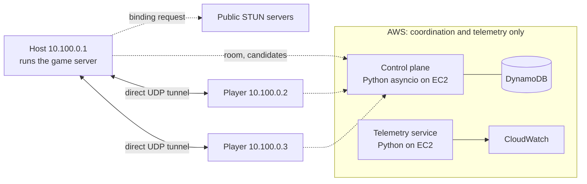
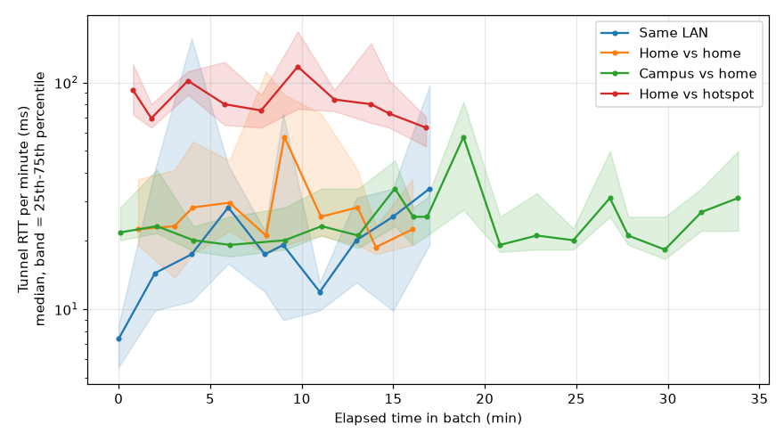
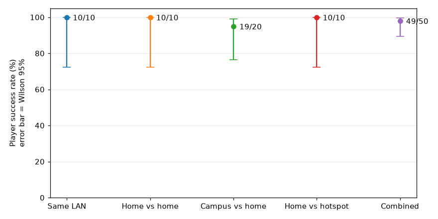

# Sangtachi

A direct-first P2P virtual LAN for multiplayer games: friends join a room with a code and reach the host's game server through a virtual IP, with no port forwarding and no relay.

**English** | [한국어](README.ko.md)

**[Spec](docs/eng/spec.md)** · **[Architecture](docs/eng/architecture.md)** · **[Field Results](docs/eng/experiments.md)** · **[Design Decisions](docs/eng/decisions/)**

## Highlights

- **49 of 50 connection attempts succeeded directly** across 4 real network pairings (same LAN, home to home, campus to home, home to mobile hotspot) with no port forwarding and no relay. Median tunnel RTT 27.7 ms, packet loss 1 in 1,597.
- **34 minutes of continuous Minecraft Java multiplayer** with no disconnect. In a sampled window, in-game ping was a median **+3.3 ms** above the tunnel RTT. In a 4-person room on 4 different networks, all 3 host-to-player pairs connected directly.
- **Networking stack written from scratch:** an RFC 5389 STUN client, UDP hole punching, a tunnel protocol with a 20-byte header and a handshake that needs evidence in both directions, and virtual adapters on Wintun (Windows) and TUN (Linux).
- **AWS is never on the game path.** An established same-LAN tunnel stayed connected while the control plane and the telemetry service were both stopped for about **10 minutes**.
- **690+ Catch2 unit tests and 260+ pytest tests**, mutation testing on the control server and core client code, and 42 architecture decision records in Korean and English.

## About

Solo capstone project for CSP400 at DigiPen Institute of Technology (Sep 2026 to present).

Hosting a game server for friends usually means router port forwarding and knowing your public IP. Sangtachi removes the router step, which matters most where the router cannot be touched (CGNAT, dorms, a router you do not own). It does not remove all setup: the client needs administrator rights and the game server still needs a firewall exception ([`windows-prereq.md`](docs/eng/windows-prereq.md) chapter 15 Usability Limits). Each client finds its public endpoint with STUN, punches a hole through the NAT with UDP, and carries game traffic over a direct peer-to-peer tunnel. The game sees an ordinary LAN: players connect to the host at `10.100.0.1` on the game server's port, for example `10.100.0.1:25565` for Minecraft Java.

## Features

- **Rooms with a code.** The host creates a room in the GUI and shares a 6-character code. Players join with the code and a display name.
- **Member list.** Every member sees each player's name and connection status, pushed by the host over the tunnel.
- **Up to 5 people per room** in a star topology: the host runs the game server and keeps one tunnel to each player ([ADR 0006](docs/eng/decisions/0006-star-topology-no-relay.md)).
- **Clear failure codes** at each stage: `STUN_DISCOVERY_FAILED`, `CONTROL_PLANE_EXCHANGE_FAILED`, `HOLE_PUNCH_TIMEOUT`, `PEER_HANDSHAKE_FAILED`, `TUNNEL_DROPPED`.
- **Windows GUI and console, plus a Linux console client** (Ubuntu 24.04+) that joins the same rooms as Windows clients.
- **Game-agnostic tunnel.** It carries plain IPv4 packets and has no Minecraft-specific code.
- **Connection telemetry** (optional) sent to a separate service and charted in Amazon CloudWatch. See [Telemetry](#telemetry) for exactly what is sent.

## How It Works



1. **Room.** The host creates a room and players join it through the control plane, which assigns each member a virtual IP in `10.100.0.0/24`. Each client then brings up a virtual adapter (Wintun on Windows, TUN on Linux) with that IP and the `10.100.0.0/24` route.
2. **Discover and exchange.** Each client asks public STUN servers in parallel for its public IP and port, from the same UDP socket it later uses for the tunnel. If each peer sees the same endpoint from two different STUN servers, the pair meets the project's supported-network condition ([`spec.md`](docs/eng/spec.md) Supported network conditions). The control plane then hands each side the other's local and public candidates. It never sees game traffic.
3. **Punch.** Both sides send `HELLO` to each other's candidates at the same time. A session counts as connected only when both directions are proven: we received a `HELLO_ACK` echoing our nonce, and we answered a valid `HELLO` from the peer.
4. **Tunnel.** IP packets read from the virtual adapter are wrapped in `DATA` packets and sent straight to the peer. The receiver checks the inner IPv4 source and destination before injecting them. The adapter MTU is 1400 to leave room for the tunnel header ([`protocol.md`](docs/eng/protocol.md) chapter 12). A maximum-size test on one home-to-home path showed no IP fragments ([`experiments.md`](docs/eng/experiments.md) chapter 2 Adapter MTU).
5. **Keep alive.** A keepalive every 15 seconds holds the NAT mapping open, and `PING`/`PONG` every 5 seconds measures RTT. A peer that goes silent for 50 seconds ends with `TUNNEL_DROPPED`.

The wire format is in [`protocol.md`](docs/eng/protocol.md), the threads and event loop in [`concurrency.md`](docs/eng/concurrency.md), and the control plane API and DynamoDB schema in [`control_plane.md`](docs/eng/control_plane.md).

## Results

Phase 9 field measurements from Nov 2026. Each trial started a console player fresh, waited for the connection, and held it 30 seconds; these trials ran without the virtual adapter, so they measure connection setup and the tunnel, and the Minecraft results below cover gameplay. Full tables, method, and limits are in [`experiments.md`](docs/eng/experiments.md).

| Environment | Success | Player setup time (median) | Tunnel RTT (median) | Loss |
|---|---|---|---|---|
| Same LAN | 10/10 | 10.6 s | 18.7 ms | 0/330 |
| Home to home | 10/10 | 10.9 s | 25.3 ms | 0/330 |
| Campus to home | 19/20 | 10.8 s | 23.5 ms | 1/623 |
| Home to mobile hotspot | 10/10 | 10.1 s | 79.7 ms | 0/314 |
| **Combined** | **49/50** | **10.8 s** | **27.7 ms** | **1/1597** |





**Minecraft Java Edition.** A 41-minute session between a Linux host on a mobile hotspot and a Windows player on home Wi-Fi held 34 minutes of continuous play before a planned Wi-Fi cut test. In a window of about 2 minutes 46 seconds, 21 in-game ping readings paired with the nearest tunnel RTT sample differed by a median of +3.3 ms. A 16 MiB file transfer over the same build matched SHA-256 on both ends.

**Limits.** The results come from 4 networks, and back-to-back trials on one network are repeated measurements, not independent ones. The one real failure was a `HOLE_PUNCH_TIMEOUT` on the campus network, where the two STUN servers returned different public ports. Destination-dependent NAT mapping was tested only by emulation and connected 0 of 10 times, as expected for a design with no relay ([ADR 0001](docs/eng/decisions/0001-no-direct-connection-fallback.md)).

## Built With

- **Client:** C++20, CMake + Ninja, Winsock2, Wintun, Windows IP Helper API, Qt 6 Widgets; POSIX sockets, TUN, and rtnetlink on Linux
- **Servers:** Python (asyncio), boto3, AWS EC2, Amazon DynamoDB, Amazon CloudWatch
- **Testing:** Catch2, pytest, DynamoDB local (Docker), custom mutation-testing runners, AddressSanitizer
- **Analysis:** Python, matplotlib

## Getting Started

### Requirements

- Windows 10 / 11 x64
- Visual Studio 2022 or later with the **Desktop development with C++** workload (installs CMake and Ninja)
- Git and network access on the first build (CMake fetches the Catch2 test framework from GitHub)
- PowerShell 7 (`pwsh`) for the GUI packaging script
- Administrator rights to run the client, because creating the Wintun adapter and route needs them ([`windows-prereq.md`](docs/eng/windows-prereq.md) chapter 1)
- Linux console client: see [`linux-prereq.md`](docs/eng/linux-prereq.md)

### Build

```powershell
powershell -ExecutionPolicy Bypass -File scripts/build.ps1
```

By default, build output goes **outside the repository**. The location is chosen in this order:

1. The `-BuildDir` argument, used as given
2. The first non-blank, non-comment line of `scripts/build-root.local` plus `\<Config>` (for example `C:\me\build` gives `C:\me\build\Debug`). The line must be a drive-letter path or a full UNC path with server and share; `..\build`, `\build`, and `\\server` are rejected
3. Otherwise `%LOCALAPPDATA%\Sangtachi\build\<Config>`

`build-root.local` differs per machine, so it is not committed (`.gitignore`). The reason for building outside the repo is at the top of `scripts/build.ps1`.

To build the GUI distribution folder (needs CMake 3.24 or later for `--fresh`, and Qt 6 from the standard Qt installer: `-QtDir` is the MSVC 64-bit kit root, and the script also copies `Licenses\LICENSE` from two levels above it):

```powershell
$Server = 'your-control-server.example.com'   # name or IPv4
$QtDir  = 'C:\Qt\6.12.0\msvc2022_64'          # your Qt MSVC 64-bit kit
pwsh -ExecutionPolicy Bypass -File scripts/package-gui.ps1 -Server $Server -QtDir $QtDir
# optional: add -Telemetry 'your-telemetry-host.example.com' to turn telemetry on
```

The control server address is not stored in the repo; whoever builds the distribution passes it with `-Server`. `-Telemetry` sets the GUI's telemetry address. Without it the packaged GUI sends no telemetry. The console client can also take `--telemetry` at startup.

### Test

```powershell
powershell -ExecutionPolicy Bypass -File scripts/test.ps1
```

- Unit tests (`ctest`) run in parallel, one per core. `-Jobs 1` runs them one at a time
- Without `-Filter` or `-Asan`, `cli-check.ps1` and `e2e-check.ps1` run after the unit tests
- `-Full` adds the representative cases of `lobby-check.ps1` and `session-check.ps1`
- `-Slow` includes `-Full` and runs the remaining cases of both scripts plus the 20-sample RTT baseline. When to run them is in `CLAUDE.md`
- `-Full` and `-Slow` are not combined with `-Filter` or `-Asan`
- `lobby-check.ps1` and `session-check.ps1` start the control server harness (`control-server/tests/harness/`). They need a DynamoDB local container and `control-server/.venv`; the commands are in [`control-server/README.md`](control-server/README.md). If either is missing they fail instead of skipping

### Run

From an elevated PowerShell. Unless the build has a control server address compiled in (the GUI distribution does), `--server` is required:

```powershell
$Client = "$env:LOCALAPPDATA\Sangtachi\build\Debug\client\sangtachi_client.exe"   # default build path
# host: creates a room and prints the room code
& $Client host --server your-control-server.example.com --name alice
# player: joins that room with the code the host got
& $Client player --server your-control-server.example.com --room K7M2QX --name bob
```

The GUI distribution from `package-gui.ps1` has the server address built in; run `sangtachi_gui.exe` from its folder.

`.env.example` is the template for local environment variables. Copy it to `.env` when you need one; `.env` is not committed.

```bash
cp .env.example .env
```

### Playing Minecraft over Sangtachi

1. **Host:** open Sangtachi, create a room, and share the room code. Start the Minecraft server with `server-ip=` left empty in `server.properties` so it listens on the virtual adapter too.
2. **Players:** open Sangtachi, enter a name and the room code, and join. Wait until the host shows as Connected.
3. **In Minecraft:** Multiplayer, Direct Connection, `10.100.0.1:25565`. The server will not appear in the "LAN games" list, because the tunnel carries no multicast.

## Telemetry

The client can send connection quality records to the telemetry service. The console client takes the service address from the `--telemetry` argument or the build default; the GUI uses only the build default set with `package-gui.ps1 -Telemetry`. If no address is set, nothing is sent. There is no consent dialog, so this section summarizes what is sent. The full field list is in [`architecture.md`](docs/eng/architecture.md) 6.3 Telemetry Service Interface.

**Sent.**

- When an attempt's setup ends: the result code (success, a failure code, or an abort), the setup time (only on success), and three NAT observations (whether the local and public addresses differ, whether the two STUN servers saw the same endpoint, whether the peer has the same public IP). All three are true/false, or `null` when the attempt ended before they were observed. The addresses themselves are not sent
- Every 60 seconds while connected, and at the end: RTT samples, jitter, expected and accepted packet counts (loss is derived from these), and bytes sent and received. The final record also carries the session result, duration, and totals
- Grouping keys: a random value created on each run, the attempt number, and a send sequence number
- The room code, the client's own `peer_id` and the counterpart's `peer_id` assigned by the control plane, and the role (host or player)
- The OS (Windows or Linux), GUI or console, and whether it is a test build

**Not sent.** IP addresses and ports, connection candidates, display names, network information, device identifiers. The telemetry service does not log source IPs.

## Repository Layout

```
client/            C++ client (include/ and src/)
control-server/    Control plane (Python)
telemetry-server/  Telemetry service (Python)
cmake/             CMake modules
tests/             Client tests
scripts/           Build, test, and packaging scripts
docs/kor/          Spec, plan, design decisions, commit history (Korean, the original)
docs/eng/          English mirror of the same documents
tools/             Doc gate, prerequisite checks, NAT measurement, deployment, telemetry analysis and plots
```

## What I Learned

- **Measurement code needs the same scrutiny as product code.** Early loss numbers counted `HELLO` packets sent to candidate addresses that could never answer ([Issue 0009](docs/eng/issue_history/0009-닿지-않는-후보로-보낸-hello-가-손실로-세졌다.md)). I moved loss accounting to start at the peer's connected signal ([ADR 0041](docs/eng/decisions/0041-loss-accounting-starts-at-peer-connected-signal.md)) and re-measured with the fixed build.
- **"Connected" has to be proven from both sides.** A one-way success looks like a working tunnel until real traffic flows, which is why the handshake requires evidence in both directions.
- **Observe NAT behavior instead of guessing NAT type.** Two STUN queries from one socket show whether the mapping stayed the same for two destinations. In the only real failure, the two servers returned different public ports. That was the clue pointing at the campus network's mapping, though the records cannot confirm the cause or tell whether the mapping depended on the destination or changed between the two requests.
- **Write decisions down.** Keeping ADRs and issue reports made it possible to revisit trade-offs like leaving out a relay with data instead of memory.

## License

MIT. See [LICENSE](LICENSE).
