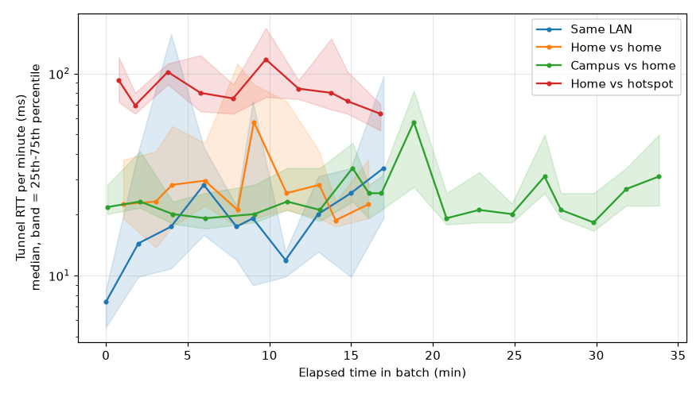
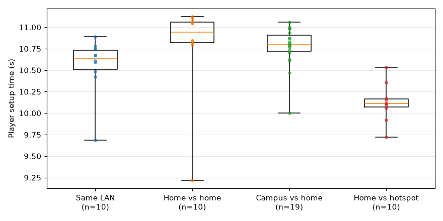
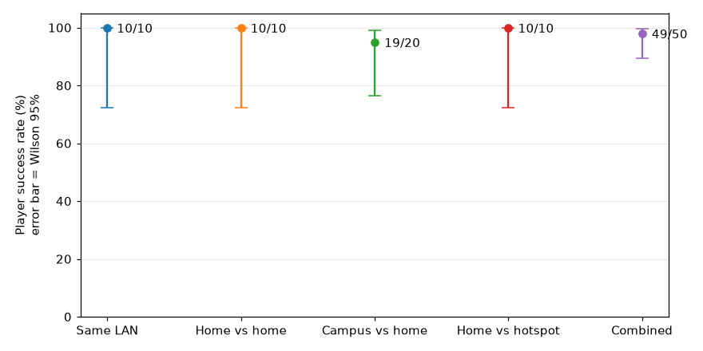

# Experiments

**이 문서는 실측 결과와 그 한계를 싣는다.** 무엇을 언제 재는지와 통과 조건은 [`roadmap.md`](roadmap.md) 가 갖는다. 사람이 아직 해야
하는 실측은 [`field-test/required-test.md`](../../field-test/required-test.md) 가 갖는다. 원본 로그는 공개하지 않는다.

## 1. 표기

- 망은 가명으로 적는다. 공인 주소와 포트를 싣지 않는다. 시각은 날짜까지만 적는다. 근거는 [ADR 0001](decisions/0001-직접-연결-대비책-미도입.md) 이다
- 기기는 `A`, `B`, `C`, `F`, `G` 로 적는다. `A` 는 저장소 소유자의 Windows 기기, `G` 는 소유자의 Linux 기기(`linux-prereq.md`), `C` 는 시연 플레이어의 Windows 기기, `F` 는 소유자의 친구의 Windows 기기다
- 3장과 4장의 터널 RTT 는 클라이언트 로그의 `session.rtt` 줄이다([`architecture.md`](architecture.md) 9장 로그 출력). `PING`/`PONG` 의 왕복이다
- 3장과 4장의 손실은 로그의 `session.loss` 줄이다. 받는 쪽이 센 값이다
- 6.2~6.4 의 값은 분석 스크립트가 텔레메트리 레코드에서 낸 것이고 그림 1 은 CloudWatch 지표다. 6.5 는 두 기기의 클라이언트 로그다. 무엇을 어느 레코드에서 세는지는 [`tools/tm-analysis`](../../tools/tm-analysis/README.md) 가 갖는다
- 중앙값과 사분위수는 표본을 정렬해 선형 보간으로 구한다

## 2. 어댑터 MTU

[`protocol.md`](protocol.md) 12장의 어댑터 MTU 1400 을 확정한 실측이다.

| 항목 | 값 |
|------|-----|
| 경로 | 두 집의 Wi-Fi 와 가정용 공유기 사이 한 경로 |
| 내부 최대 크기 | `ping -f -l 1372` 가 4/4 성공했다. `-l 1373` 은 DF 로 거절됐다. 1372 는 어댑터 MTU 1400 에서 IPv4 헤더 20 과 ICMP 헤더 8 을 뺀 값이다 |
| 터널 최대 크기 | 콘솔 `send 1 1452` 가 B 에서 A 로 바깥 IPv4 1500바이트 한 개로 왔다. 캡처 전체에 IP 조각이 없었다 |

**이 값이 덮지 못하는 경로.**

- 한 경로의 한 방향(B 에서 A)만 최대 크기를 봤다
- 바깥 패킷은 최대 1448바이트다. 경로 MTU 가 그보다 작으면 DF 를 세우지 않으므로 IP 조각으로 간다. 조각이 중간 장비와 NAT 를 지나는지는 재지 않았다
- VPN 위의 실행과 기업망은 재지 않았다. 모바일 테더링은 아래 3장 세션이 지났으나 최대 크기를 따로 재지 않았다

## 3. Minecraft 세션

### 3.1 첫 세션

[`roadmap.md`](roadmap.md) Phase 8 검증의 일부를 처음 돈 기록이다. 빌드는 `field-kit-p7b` 이고 Phase 7 의 파일 전송 시험과 같은 터널 빌드다.

| 항목 | 값 |
|------|-----|
| 날짜 | 2026-10-28 |
| 망 | A 는 망 P(휴대폰 핫스팟), B 는 망 L(학교 도서관 유선 LAN). 망 L 의 구성은 모른다 |
| 역할 | A 가 호스트이고 Minecraft 서버를 돌렸다. B 가 플레이어다 |
| NAT | 양쪽 모두 로컬 주소와 공인 주소가 달랐다. 양쪽 모두 두 STUN 서버가 같은 공인 엔드포인트를 봤다 |
| 수립 | 성공. 수립 시간 A 6484ms, B 7016ms (로컬 기록 파일의 `setup_ms`) |
| 세션 길이 | `CONNECTED` 진입부터 `CLOSED` 까지 약 3분 51초. 양쪽 모두 프로세스 종료로 끝냈다(`attempt.end reason=shutdown`) |
| 터널 RTT | A 46개, 중앙값 82.4ms, 사분위 범위 65.7~126.9ms. B 45개, 중앙값 83.1ms, 사분위 범위 59.5~99.1ms |
| RTT 최대 | 양쪽 모두 같은 때에 한 번 약 2.3초. 그 밖의 표본은 300ms 아래였다 |
| 손실 | A 가 받은 쪽 34/17303(0.20%), B 가 받은 쪽 25/18000(0.14%) |
| 전송량 | 터널 소켓 기준 A 송신 약 12.1MB, A 수신 약 1.1MB |
| 사람의 관찰 | 로그인과 월드 진입에 성공했다. 플레이 중 지연이나 끊김을 느끼지 못했다 |

**이 세션이 판정하지 않는 것.**

- 30분 연속 플레이(T-5). 세션이 4분이 되지 않는다
- 게임 표시 지연과 터널 RTT 의 차이. 게임 표시값을 기록하지 않았다
- 블록 배치와 채팅의 반영 시간
- 약 2.3초 RTT 의 원인. 두 망 가운데 어느 쪽인지 가를 자료가 없다

### 3.2 두 번째 세션

`roadmap.md` Phase 8 검증 가운데 두 기기로 되는 것을 한 세션에서 돈 기록이다. 소유자 혼자 A 와 G 로 돌았다.

| 항목 | 값 |
|------|-----|
| 날짜 | 2026-11-01 |
| 빌드 | `field-kit-p8`([ADR 0036](decisions/0036-phase-8-minecraft-검증-키트.md)). G 는 Linux Release 콘솔, A 는 GUI 배포물이다. A 의 배포물은 그 직전 커밋으로 만들었고 둘 사이의 차이는 Linux 플랫폼 파일 하나다 |
| 망 | G 는 망 P(휴대폰 핫스팟), A 는 망 H(집 Wi-Fi) |
| 역할 | G 가 호스트이고 Minecraft 서버와 클라이언트를 돌렸다. A 가 플레이어다 |
| NAT | 양쪽 모두 로컬 주소와 공인 주소가 달랐다. 양쪽 모두 두 STUN 서버가 같은 공인 엔드포인트를 봤다 |
| 수립 | 성공. 수립 시간 G 6266ms, A 7172ms (로컬 기록 파일의 `setup_ms`) |
| 세션 길이 | `CONNECTED` 진입부터 약 41분 17초. 아래 60초 Wi-Fi 끊김으로 양쪽 모두 `TUNNEL_DROPPED` 로 끝났다 |
| 터널 RTT | G 480개, 중앙값 83.1ms, 사분위 범위 66.8~144.0ms, 최대 약 3.5초. A 470개, 중앙값 80.1ms, 사분위 범위 64.3~136.2ms, 최대 약 1.2초 |
| 손실 | G 가 받은 쪽 2927/155959(1.88%), A 가 받은 쪽 222/124680(0.18%). 두 번의 Wi-Fi 끊김 동안 잃은 것을 포함한다 |

**결과.**

| 검증 | 결과 |
|------|------|
| 파일 전송(NFR-2) | 통과. 같은 빌드로 Minecraft 전에 A 에서 G 로 16 MiB 를 보냈고 양쪽 SHA-256 이 같았다. 받는 쪽은 `Test-Transfer.ps1` 과 같은 와이어의 Python 수신기였다 |
| 30분 연속 플레이(T-5) | 통과. 두 계정이 들어온 뒤 약 34분 동안 서버 로그에 접속 끊김이 없고 양쪽 세션이 `CONNECTED` 였다. 그 뒤 Wi-Fi 끊김 시험으로 넘어갔다 |
| 게임 표시 지연과 터널 RTT | 통과. 게임 표시 지연 21개, 중앙값 72ms, 사분위 범위 71~74ms. 같은 약 2분 46초 구간의 터널 RTT 33개, 중앙값 68.2ms, 사분위 범위 64.3~78.7ms. 판정은 두 중앙값의 비교다. 차이(게임 − 터널)는 중앙값 +3.3ms, 사분위 범위 +0.6~+8.1ms 다. 차이는 판독마다 시각이 가장 가까운 터널 표본 하나와 짝지었다(시각 차 2.1초 이하) |
| 블록 배치와 채팅 | 통과. 소유자가 두 화면에서 눈에 띄는 지연 없이 반영되는 것을 봤다 |

**Wi-Fi 끊김 거동.** 판정하지 않고 기록만 한다. A 의 Wi-Fi 연결을 `netsh wlan disconnect` 로 끊고 정한 시간 뒤 다시 붙였다. 무선을
끈 것이 아니라 연결을 끊은 것이다. 시각은 두 기기 시계를 같은 NTP 서버에 대 맞췄다.

| 끊은 시간 | 거동 |
|-----------|------|
| 약 10초 | G 에서 A 로 가는 `ping` 이 약 10.8초 끊겼다. A 는 다시 붙인 뒤 약 0.7초에 터널이 돌아왔다. 양쪽 세션은 `CONNECTED` 를 유지했다. Minecraft 는 잠깐 멈췄다가 이어졌다 |
| 약 60초 | 약 20초 뒤 Minecraft 서버가 A 의 플레이어를 `Timed out` 으로 내보냈고 A 화면에 연결 끊김이 떴다. 끊은 뒤 약 50초에 양쪽이 `session.failed code=TUNNEL_DROPPED` 를 냈다. 유휴 타임아웃 50초([`protocol.md`](protocol.md) 11장 타이머)와 맞는다. A 의 GUI 는 로비로 갔고 `FAIL TUNNEL_DROPPED galaxyhost The connection to the other player was lost. They may have left, or the network is unstable.` 을 보였다. G 는 방에 남았다. Wi-Fi 가 돌아온 뒤 다시 붙지 않는다. 다시 참가해야 한다 |

**이 세션의 한계.**

- 게임 표시 지연은 F3 의 Ping 그래프가 보이는 min/avg/max 가운데 avg 를 읽었다. 순간값이 아니라 그래프 구간의 평균이고, 이웃한 판독의 구간이 겹쳐 서로 독립이 아니다
- 터널 RTT 의 구간은 G 의 로그에서 잘랐다. A 의 로그 줄에는 시각이 없다. 같은 세션의 왕복이다
- 파일 전송 동안 A 가 `socket.error op=sendto code=10035`(`WSAEWOULDBLOCK`) 를 265번 냈다. 송신 버퍼가 차서 그 데이터그램을 버린 것이고(`tx_err_send` 266) TCP 가 다시 보냈다. Minecraft 플레이 중에는 없었다
- 세션 하나, 망 한 쌍이다. 시연 플레이어와 호스트 사이의 망 쌍은 아니다. 이 두 망은 [ADR 0038](decisions/0038-시연-호스트를-집-wi-fi-에-둔다.md) 의 시연에서 호스트와 소유자 사이에 역할을 바꿔 쓰인다

### 3.3 시연 리허설

`roadmap.md` Phase 8 작업의 시연 전 리허설이다([ADR 0037](decisions/0037-시연-전-확인을-리허설-한-번으로.md)). 그때 정한 시연 망 쌍이다. 시연 망은 그 뒤 바뀌었다([ADR 0038](decisions/0038-시연-호스트를-집-wi-fi-에-둔다.md)).

| 항목 | 값 |
|------|-----|
| 날짜 | 2026-11-02 |
| 빌드 | `field-kit-p8`. 3.2 와 같은 두 실행 파일이다. C 도 A 와 같은 GUI 배포물을 썼다. 키트가 바뀌지 않아 파일 전송은 다시 돌지 않았다([ADR 0036](decisions/0036-phase-8-minecraft-검증-키트.md)) |
| 망 | G 는 망 P(학교에서 소유자의 휴대폰 핫스팟), C 는 망 R(시연 플레이어의 집 Wi-Fi). A 는 망 S(학교 유선 LAN)와 망 P 의 Wi-Fi 에 함께 붙어 있었다 |
| 역할 | G 가 호스트이고 Minecraft 서버를 돌렸다. C 와 A 가 플레이어다 |
| NAT | G 와 C 모두 로컬 주소와 공인 주소가 달랐고 포트도 바뀌었다. 양쪽 모두 두 STUN 서버가 같은 공인 엔드포인트를 봤다 |
| 수립 | 성공. G 와 C 사이 세션의 수립 시간 G 6159ms, C 9204ms (로컬 기록 파일의 `setup_ms`) |
| 세션 길이 | G 와 C 사이 세션이 `CONNECTED` 진입부터 약 10분 14초. C 가 창을 닫아 `CLOSED` 로 끝났다 |
| 터널 RTT | G 118개, 중앙값 199.0ms, 사분위 범위 192.3~209.3ms, 최대 319.0ms. C 122개, 중앙값 198.9ms, 사분위 범위 191.2~207.1ms, 최대 330.7ms |
| 손실 | G 가 받은 쪽 0/29106, C 가 받은 쪽 7/27069(0.03%) |
| 사람의 관찰 | C 와 A 가 Minecraft 서버에 로그인해 월드에 들어갔다. C 는 약 5분 머물렀다 |

**결과.** 리허설 통과. 방 만들기, 참가, Minecraft 접속까지 됐다.

**이 세션의 한계.**

- 시연 당일의 망 상태는 판정하지 않는다. 그 사이 조건이 바뀌면 시연에서 처음 드러난다(ADR 0037)
- 30분 연속 플레이가 아니다. C 의 플레이는 약 5분이다
- A 가 두 망에 함께 붙어 있는 동안 G 가 처음 약 1분 동안 A 의 엔드포인트를 두 주소 사이에서 27번 바꿨다(`session.endpoint`). 그 뒤 하나로 머물렀고 A 쪽 손실은 9/33717 이었다. 원인은 보지 않았다

### 3.4 새 시연 망의 리허설

[ADR 0038](decisions/0038-시연-호스트를-집-wi-fi-에-둔다.md) 의 시연 망으로 한 리허설이다.

| 항목 | 값 |
|------|-----|
| 날짜 | 2026-11-02 |
| 빌드 | `field-kit-p8`. 3.3 과 같은 실행 파일이다 |
| 망 | G 는 망 H(소유자의 집 Wi-Fi), A 는 망 P(휴대폰 핫스팟), C 는 망 R, F 는 망 W |
| 역할 | G 가 호스트이고 Minecraft 서버를 돌렸다. A, C, F 가 GUI 로 참가한 플레이어다 |
| 수립 | 세 쌍 모두 직접 연결. 호스트의 수립 시간 F 5978ms, A 6654ms, C 6082ms (로컬 기록 파일의 `setup_ms`) |
| 세션 길이 | 약 8분에서 11분. 세 플레이어 모두 나가기나 창 닫기로 끝냈고 호스트가 `CLOSED` 를 받았다 |
| 멤버 목록 | A 의 창에 네 멤버가 모두 Connected 로 보였다. C 와 F 의 명부에도 네 멤버가 연결 비트 1 로 왔다 |
| 사람의 관찰 | 세 플레이어가 Minecraft 서버에 로그인해 월드에 들어갔다. 서버 로그에 시간 초과로 끊긴 플레이어가 없다 |

| 플레이어 | 터널 RTT, G 쪽 | 터널 RTT, 플레이어 쪽 | 손실, G 가 받은 쪽 | 손실, 플레이어가 받은 쪽 |
|----------|---------------|-----------------------|--------------------|--------------------------|
| F | 129개, 중앙값 17.9ms, 사분위 범위 14.8~24.1ms, 최대 194.1ms | 129개, 중앙값 18.1ms, 사분위 범위 14.4~24.2ms, 최대 246.8ms | 0/42042 | 41/43426(0.09%) |
| A | 117개, 중앙값 117.9ms, 사분위 범위 93.4~209.6ms, 최대 866.7ms | 119개, 중앙값 131.3ms, 사분위 범위 101.4~231.1ms, 최대 894.8ms | 35/42686(0.08%) | 650/37610(1.73%) |
| C | 98개, 중앙값 181.2ms, 사분위 범위 172.4~212.1ms, 최대 321.5ms | 98개, 중앙값 185.4ms, 사분위 범위 171.3~235.8ms, 최대 320.2ms | 1/18604 | 1/17637 |

**결과.** 리허설 통과. 방 만들기, 참가, Minecraft 접속까지 됐다.

**이 세션의 한계.**

- 시연 당일의 망 상태는 판정하지 않는다(ADR 0037)
- A 의 학교 휴대폰 핫스팟 쪽이 RTT 의 흩어짐과 손실이 가장 컸다. 시연 날의 신호는 다를 수 있다
- C 가 Minecraft 에 들어오기 직전 G 가 `socket.error op=sendto code=11`(`EAGAIN`) 을 40번 냈다. 송신 버퍼가 차서 그 데이터그램을 버린 것이다. 3.2 의 `10035` 와 같은 종류다
- C 의 첫 기동은 서브넷 충돌 검사의 시간 초과로 끝났다([이슈 0007](issue_history/0007-첫-기동의-서브넷-검사가-상한을-넘겼다.md)). 다시 띄운 프로세스로 참가했다

## 4. 멤버 목록과 단절

`roadmap.md` Phase 8 검증의 T-7 이다.

### 4.1 세 기기

3.3 과 같은 날, 같은 기기와 망이다. 호스트가 명령줄로 띄운 콘솔이라 `spec.md` T-7 의 "GUI 만으로" 는 4.2 가 판정한다.

| 항목 | 값 |
|------|-----|
| 날짜 | 2026-11-02 |
| 역할 | G 가 호스트(Linux 콘솔), C 가 멤버 목록을 보는 플레이어(GUI), A 가 끊기는 플레이어(GUI)다 |
| 판정 시한 | 호스트가 단절을 안 때에 명부 주기 한 번을 더한 값이다(`roadmap.md` Phase 8 검증) |
| 시각 | 호스트가 안 때는 G 의 로그 줄에 붙인 받은 시각이다. C 의 로그 줄에는 시각이 없다. C 가 명부를 받은 때는 C 의 로그에서 `CONNECTED` 뒤 5초 간격 `PING` 타이머 줄을 세어 5초 폭으로 잡았다. 같은 수립에서 C 와 G 의 기록 파일 시각은 0.02초 차이였다 |

| 끊는 방법 | 호스트 | C 의 멤버 목록 | 판정 |
|-----------|--------|----------------|------|
| A 의 창을 닫는다 | `CLOSE` 를 받아 `CLOSED` | 호스트가 안 뒤 1.9초 안에 A 가 끊긴 것으로 바뀌었다(연결 비트 0). 다음 명부에서 줄이 빠졌다. 사람은 "거의 바로" 로 봤다 | 통과 |
| A 를 `taskkill /F` 로 끝낸다 | 유휴 타임아웃으로 `session.failed code=TUNNEL_DROPPED` | 호스트가 안 뒤 5초 안에 A 가 끊긴 것으로 바뀌었다. 사람은 끊은 뒤 약 47초로 봤다 | 통과 |
| 호스트를 끝낸다 | 정상 종료 | 0.12초 뒤 `CLOSED`, `attempt.end reason=closed`. 창은 로비로 돌아갔다 | 통과 |

**이 측정의 한계.**

- 작업 관리자의 "프로세스" 탭에서 끝낸 첫 시도는 창에 닫기 신호가 가서 정상 종료로 돌았다. 판정에 넣지 않았다
- 강제 종료의 47초는 사람이 끊은 때부터 센 값이다. 끊은 때는 로그에 없다

### 4.2 GUI 만의 흐름

`spec.md` T-7 의 통과 조건을 GUI 기기 둘로 이어서 돈 기록이다. 두 기기 모두 명령줄 인자 없이 띄웠다.

| 항목 | 값 |
|------|-----|
| 날짜 | 2026-11-02 |
| 빌드 | `field-kit-p8` GUI 배포물. 두 기기가 같은 배포물이다 |
| 망 | A 는 망 P(휴대폰 핫스팟), F 는 망 W(친구의 집 Wi-Fi) |
| 역할 | A 가 호스트, F 가 플레이어다 |
| 수립 | 성공. 직접 연결이다. 양쪽 모두 로컬 주소와 공인 주소가 달랐다 |

| 조건 | 근거 | 판정 |
|------|------|------|
| 호스트가 방을 만들어 코드를 읽는다 | A 의 창에 방 코드가 보였다 | 통과 |
| 플레이어가 그 코드로 참가한다 | F 가 `CONNECTED` 에 들었다 | 통과 |
| 양쪽 목록에 상대의 이름이 보인다 | F 의 명부에 두 멤버가 연결 비트 1 로 왔다. A 의 창에 F 가, F 의 창에 A 가 Connected 로 보였다(소유자의 관찰과 F 의 관찰을 소유자가 전한 것) | 통과 |
| 한쪽을 끊으면 다른 쪽 목록에서 끊긴 것으로 바뀐다 | F 가 창을 닫았다(`attempt.end reason=shutdown`). A 가 `CLOSE` 를 받아 `CLOSED` 로 갔고 A 의 목록에서 F 의 줄이 빠졌다 | 통과 |
| 실패 코드를 보인다 | F 가 없는 방 코드로 참가했다. `room_not_found` 를 받고 창의 상태 줄에 `FAIL CONTROL_PLANE_EXCHANGE_FAILED` 와 안내 문장을 보였다 | 통과 |

**결과.** T-7 통과. 4.1 과 함께 `roadmap.md` Phase 8 검증의 T-7 조건을 모두 돌았다.

**함께 본 것.** 같은 두 기기로 방을 다시 만들고 A 의 Minecraft 가 싱글 월드를 LAN 에 공개했다. F 가 A 의 가상 IP 와 그 포트로 들어가 약 48초 머물렀다. 따로 띄운 서버가 아니어도 터널 위에서 접속됐다.

**이 측정의 한계.**

- A 의 목록은 F 의 줄이 빠진 뒤의 화면만 캡처했다. 연결 비트 0 의 중간 표시는 기록하지 않았다
- 망 한 쌍이다

## 5. 텔레메트리 표의 한계

`roadmap.md` Phase 9 의 분석 스크립트([`tools/tm-analysis`](../../tools/tm-analysis/README.md))가 내는 표를 읽을 때의 한계다. 무엇을
어떻게 세는지는 `roadmap.md` Phase 9 작업이 갖는다. 결과는 6장이다.

**`room_known` 거르기.**

- `OK` 인데 `room_known` 이 `true` 가 아닌 시도는 성공에서도 분모에서도 빠진다. 방 항목이 지워진 뒤에 온 진짜 레코드와
  대조 읽기가 실패한 레코드가 여기에 든다([`architecture.md`](architecture.md) 3.4 방 대조). 그 수는 "제외한 OK" 로 따로 적는다
- 실패는 `room_known` 과 무관하게 센다. 수립 전 실패에는 대조할 방이 없기 때문이다. 그래서 가짜 실패 레코드는 거르지 못하고 실패율을 올릴 수 있다
- 대조는 방이 있는지만 본다. 살아 있는 방 코드를 아는 사람이 보낸 가짜 레코드는 성공에도 세션 값에도 들어간다

**잃은 레코드.**

- `establish`(전송 순번 0)를 잃고 뒤 레코드만 온 시도는 시도 분모에서 빠진다. 그 시도의 누락 수는 적어도 1이고, 다른 빈 번호가 있으면 함께 더해진다
- 시도의 마지막 레코드나 시도 전체를 잃은 것은 누락 수에도 보이지 않는다
- 세션이 `end` 없이 끝나면 그 세션은 손실과 세션 지속 시간에서 빠진다

**지터.** 레코드의 `jitter_us` 는 구간 끝의 평활 지터 하나다(`architecture.md` 9장 텔레메트리 업로드). 표의 지터 중앙값은
"구간 끝 평활 지터들의 중앙값" 이다. 연속 RTT 표본 차이들의 중앙값이 아니다. RFC 3550 의 지터와 비교하지 않는다.

## 6. 연결 수립과 세션 품질

`roadmap.md` Phase 9 의 실측이다. 표의 숫자는 분석 스크립트([`tools/tm-analysis`](../../tools/tm-analysis/README.md))가 텔레메트리 테이블에서 낸 값이다. 읽는 법과 한계는 5장이다. 그래프는 [`tools/tm-plot`](../../tools/tm-plot/README.md) 이 그렸다([ADR 0042](decisions/0042-실측-그래프는-분석-도구가-그린다.md)).

### 6.1 구성

| 항목 | 값 |
|------|-----|
| 날짜 | 2026-11-19, 2026-11-23. 통제된 실패 둘은 2026-11-17 |
| 빌드 | 커밋 `6e6f5e4` 의 Release 콘솔. 통제된 실패 둘은 커밋 `5f9f710` 이다. 둘 다 가상 어댑터 없이 돌렸다(`--no-adapter`) |
| 시행 | 플레이어를 새로 띄워 `CONNECTED` 나 실패 코드까지 본다. 연결되면 30초 유지하고 끝낸 뒤 60초 쉰다. 통계 설계는 `roadmap.md` Phase 9 가 갖는다 |
| 손실 | 손실 집계를 고친 빌드로 잰 묶음만 싣는다([ADR 0041](decisions/0041-손실-집계는-상대의-연결-신호부터-센다.md)). 그 전에 잰 묶음은 표에서 뺐다 |

| 환경 | 호스트 | 플레이어 | 묶음 |
|------|--------|----------|------|
| 동일 LAN | G, 망 H | A, 망 H | 10회 |
| 가정망 대 가정망 | F, 망 W | A, 망 H | 10회. 호스트를 한 번 띄워 10회 내내 두었다 |
| 캠퍼스망 대 가정망 | G, 망 H | A, 망 S | 10회 두 묶음 |
| 가정망 대 핫스팟 | G, 망 P | A, 망 H | 10회 |
| 에뮬레이션한 목적지 의존 매핑 | A, 망 P | G 의 네트워크 네임스페이스, 망 H 위([ADR 0040](decisions/0040-목적지-의존-매핑-에뮬레이션.md)) | 10회 |

### 6.2 실제 환경

| 환경 | 성공/시도 | 플레이어 수립 시간 중앙값 (사분위 범위) | 호스트 수립 시간 중앙값 | RTT 중앙값 (사분위 범위) | 지터 중앙값 | 손실 |
|------|-----------|------------------------------------------|-------------------------|--------------------------|-------------|------|
| 동일 LAN | 10/10, Wilson 95% 72.2~100.0% | 10641.0ms (10512.2~10730.5) | 6015.5ms | 18.7ms (10.5~40.6), n=120 | 9.6ms | 0/330 |
| 가정망 대 가정망 | 10/10, Wilson 95% 72.2~100.0% | 10945.5ms (10820.8~11059.0) | 6188.0ms | 25.3ms (18.7~57.4), n=120 | 7.7ms | 0/330 |
| 캠퍼스망 대 가정망 | 19/20, Wilson 95% 76.4~99.1% | 10797.0ms (10718.5~10906.0) | 6170.0ms | 23.5ms (19.0~33.2), n=225 | 3.1ms | 1/623 (0.16%) |
| 가정망 대 핫스팟 | 10/10, Wilson 95% 72.2~100.0% | 10110.0ms (10070.0~10168.0) | 6259.0ms, n=9 | 79.7ms (65.9~106.4), n=113 | 8.6ms | 0/314 |
| 합산 | 49/50, Wilson 95% 89.5~99.6% | 10750.0ms (10422.0~10875.0) | 6188.0ms | 27.7ms (18.9~65.8), n=578 | 6.6ms | 1/1597 (0.06%) |

- 성공한 49회는 모두 `CLOSED` 로 끝났다. 세션 지속 시간 중앙값은 30.2초다
- 플레이어와 호스트의 수립 시간은 기점이 달라 서로 비교하지 않는다([`architecture.md`](architecture.md) 9장)
- 빈 seq 로 보인 누락은 가정망 대 핫스팟의 1 이다. 그 시행의 호스트 `establish` 가 올라오지 않아 호스트 수립 시간이 n=9 다

그림 1. 환경별 분당 터널 RTT. CloudWatch 1분 해상도 `Rtt` 지표의 분마다 중앙값이고 띠는 사분위 범위다. 두 기기의 표본을 함께 담는다. 가로축은 묶음 안 경과 시간이고, 캠퍼스망은 두 묶음을 이어 붙였다. 세로축은 로그 눈금이다.

그림 2. 환경별 플레이어 수립 시간. 상자는 사분위 범위, 가운데 선은 중앙값, 수염은 최솟값과 최댓값이다. 점 하나가 성공한 시도 하나다. 실패한 시도는 수립 시간이 없어 들지 않는다.

그림 3. 환경별 플레이어 성공률과 Wilson 95% 구간.

### 6.3 매핑 거동별 비교

NAT 유형이 아니라 관측된 매핑 거동으로 가른다. `stun_same_endpoint` 는 두 STUN 서버가 본 공인 엔드포인트가 같았는지다. 호스트 값은 같은 방의 호스트 `establish` 에서 짝지었다.

| 묶음 종류 | 플레이어 `stun_same_endpoint` | 호스트 `stun_same_endpoint` | 성공/시도 |
|-----------|-------------------------------|-----------------------------|-----------|
| 실제 | true | true | 48/48 |
| 실제 | true | 짝 없음 | 1/1 |
| 실제 | false | true | 0/1 |
| 에뮬레이션 | false | true | 0/10 |

- 실제 환경의 실패 하나는 캠퍼스망 대 가정망이고 `HOLE_PUNCH_TIMEOUT` 이다. 그 시도에서 A 는 두 STUN 서버에서 다른 공인 포트를 받았다. 망 S 가 목적지마다 다른 매핑을 줬을 수도 있고, 두 요청 사이에 매핑을 바꿨을 수도 있다. 이 기록으로는 가르지 못한다. 같은 망의 나머지 19회는 두 서버가 같은 포트를 줬다
- 실패한 시도에서 두 기기는 상대의 어느 후보 주소도 확인하지 못했다
- 실제 환경 50회 모두 플레이어의 로컬 주소와 공인 주소가 달랐다(`local_differs_public`). 동일 LAN 여부(`same_lan`)는 동일 LAN 10회만 `true` 다
- 에뮬레이션은 통제 조건이라 실제 환경의 성공률에 넣지 않는다(ADR 0040). 10회 모두 플레이어의 두 STUN 포트가 달랐고, 두 쪽 모두 상대에게서 받은 데이터그램이 없었다

### 6.4 통제된 실패

실패 처리 경로의 증거이고 실패율이 아니다([`spec.md`](spec.md) A-2).

| 시나리오 | 결과 |
|----------|------|
| G 에서 그 사용자의 아웃바운드 UDP 를 DNS 만 빼고 막고 플레이어로 참가 | `STUN_DISCOVERY_FAILED`. 업로드 실패 0 |
| 제어 평면 API 로 가짜 호스트를 만들고 응답 없는 문서용 주소 하나를 후보로 등록한 뒤 A 가 참가 | `HOLE_PUNCH_TIMEOUT`. 업로드 실패 0 |

### 6.5 제어 평면 중단

2026-11-17, 커밋 `5f9f710` 빌드로 동일 LAN 의 터널을 띄운 채 제어 서버와 텔레메트리 서비스를 함께 약 10분(613초) 내렸다(NFR-3). 터널은 끊기지 않았다. 두 쪽 모두 `CONNECTED` 뒤의 상태 전이는 끝에 `quit` 으로 닫은 것 하나뿐이다. 연결된 약 630초 동안 RTT 표본은 A 122, G 123 으로 5초 주기에 기대되는 약 126 과 맞는다.

### 6.6 한계

- 망은 H, W, S, P 넷이다. 같은 날 같은 망에서 이어 돌린 10회는 독립 시행이 아니라 반복 측정이다(`roadmap.md` Phase 9 통계 설계). 다른 NAT 환경으로 일반화하지 않는다
- 실제 망에서 목적지 의존 매핑으로 보이는 망을 구하지 못했다. 그 조건은 에뮬레이션으로만 쟀다
- 가정망 대 가정망은 호스트를 계속 두었다. 이 묶음의 수립 시간은 시행마다 호스트를 새로 띄운 다른 묶음과 조건이 다르다
- 가정망 대 핫스팟과 같은 망 쌍의 다른 묶음 하나를 뺐다. 그 묶음 동안 핫스팟을 낸 휴대폰으로 동영상을 봤다. RTT 중앙값이 약 200ms 였다. 동영상이 원인이라고 확인하지는 않았다
- 가정망 대 가정망에서 A 의 Tailscale 이 켜져 있었다
- 실제 환경의 실패가 1회라 매핑 거동별 실패율을 말할 수 없다
